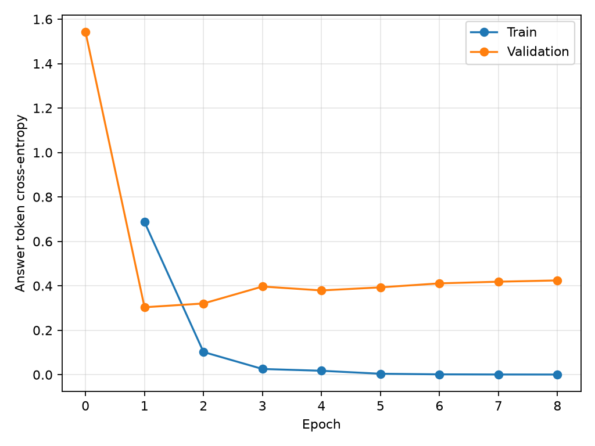

# Результаты локального SFT

Ученик: Qwen3-0.6B, LoRA SFT на 400 правильных ответах. GPU: RTX 5060 Ti 16 GB.
Учитель: ассистент этого чата; его заранее составленные ответы служат эталонами.
Неправильные ответы не использованы в SFT. Валидация: 25 вопросов, тест: 45.
Рецепты между выборками не пересекаются.

## Качество

Полностью корректные ответы: **11/45 (24.4%) → 24/45 (53.3%)**.
Исправлено ответов: 13; регрессий: 0.

| Задача | До SFT | После SFT |
|---|---:|---:|
| Вопросы по рецепту | 11/19 | 14/19 |
| Порции | 0/10 | 1/10 |
| Замены | 0/8 | 1/8 |
| Отказы | 0/8 | 8/8 |

Критерии зафиксированы в evaluation_protocol.md. Каждый ответ оценён ассистентом
по смыслу и проверяемым фактам; все решения с пояснениями находятся в review.json.
Это не независимая слепая оценка: эталоны и оценка принадлежат тому же ассистенту.
Качество учителя отдельно не измерялось: 100% совпадения с собственными эталонами
не является содержательной метрикой. В comparisons.html приведены все три ответа.
Тест маленький и синтетический; несколько вопросов используют один рецепт.
Проценты не доказывают такую же надёжность на произвольных пользовательских данных.

Строгость оценки: один исходный ответ содержал общий отказ без указания кулинарной
области и получил 0 по заранее заданному критерию. Если засчитать такой отказ,
исходный результат будет 12/45 (26.7%), а после SFT останется 24/45 (53.3%).
Для нуля порций модель после SFT дала математически верные нулевые количества,
но не выполнила предусмотренную протоколом проверку допустимости числа порций.
Это прикладная ошибка, а не ошибка умножения.

## Где ученик уже справляется, а где ещё нет

- Перечисление ингредиентов: 8/8 до и после; после встречаются опечатки названий,
  но состав и количества в этих вопросах верны. Улучшения в этой подзадаче нет.
- Отказы: 8/8 после SFT по строгому критерию, 0/8 до (1/8 при мягком критерии).
  На этих запросах ученик выполняет роль ограниченного кулинарного помощника.
- Следующий шаг: 3/9 → 6/9, включая вопрос о завершении рецепта. После последнего
  шага модель всё ещё повторяет рецепт или выдаёт постороннюю часть контекста.
- Пересчёт: 0/8 → 1/8; два дополнительных вопроса на уточнение также не пройдены.
  Надёжно заменять учителя в арифметике нельзя.
- Замены: 0/8 → 1/8 полностью корректных ответов. Иногда названа подходящая
  альтернатива, но следом идёт выдуманная инструкция. Такие ответы не засчитывались.
- Отсутствующие сведения: 0/2 до и после. Нельзя полагаться на распознавание
  недостаточной информации или на советы при аллергиях.

Пример исправления: после первого шага булгура учитель отвечает «Залейте водой
и варите 15 минут». До SFT модель предлагала обжарить булгур, после — точно
воспроизводит нужный следующий шаг.

Пример оставшейся ошибки: на 5 порций пудинга учитель даёт 75 г чиа, 500 мл молока,
300 г банана. До SFT: 135 г / 1500 мл / 900 г. После: **750 г / 500 мл / 300 г**.
Улучшение двух чисел не делает весь ответ правильным.

Пример замены: на вопрос о замене йогурта сметаной учитель предлагает 75 г сметаны.
До SFT модель запрещает замену. После называет 75 г, но добавляет «нарежьте и
слейте» — такой ответ также ошибочный.

Итог: получен рабочий обученный прототип, но не надёжный универсальный помощник.
Для следующего эксперимента полезнее расширить разнообразие рецептов, замен,
пограничных случаев и исходного числа порций, чем повторять те же примеры ещё
больше раз. В текущем обучении исходные рецепты рассчитаны на 2 или 4 порции,
а отложенные — на 3: это существенное ограничение переноса арифметики.
Для практического пересчёта разумно вынести вычисления в проверяемый калькулятор;
это предложение для следующей версии, в данном тесте инструментов у модели нет.

## Обучение и loss

Время этапа обучения: 8.34 мин; 200 шагов оптимизатора.
Начальный validation loss: 1.5417.
Лучший validation loss: **0.3036**, эпоха 1.
Train loss на этой эпохе: 0.6867.
Loss — cross-entropy по токенам правильного ответа, без токенов вопроса/рецепта.
Выбран чекпойнт с минимальным validation loss, не по результатам теста.
Снижение loss не заменяет проверку фактических ответов.

## Скорость и стоимость

| Метрика | До SFT | После SFT |
|---|---:|---:|
| Среднее время генерации, с/запрос | 2.373 | 1.575 |
| Медиана, с | 2.186 | 1.730 |
| p95, с | 5.124 | 2.234 |
| Выходных токенов/с | 20.0 | 19.4 |
| Средняя длина ответа, токены | 47.4 | 30.5 |
| Пик выделенной CUDA-памяти, GB | 1.27 | 1.28 |
| Оценка энергии GPU на запрос, Wh | 0.03117 | 0.02025 |
| Энергия GPU, RUB/1000 запросов при 6 RUB/kWh | 0.1870 | 0.1215 |

Скорость измерена локально после прогрева, batch size 1, без времени загрузки модели
и токенизации. Длины ответов различаются, поэтому сравнивайте также токены/с.
Оба запуска: BF16, greedy, thinking выключен, предел 160 новых токенов.
LoRA после обучения слит с базовыми весами для измерения.

Энергия — приближённая оценка по выборкам nvidia-smi раз в секунду, включая фон GPU,
но без CPU, памяти и других компонентов ПК. Тариф 6 RUB/kWh — пример расчёта,
не установленный тариф пользователя. Оценка энергии обучения: 12.253 Wh,
или 0.0735 RUB по тому же условному тарифу. Амортизация, труд и загрузки не включены.
Плата за API локальной модели равна нулю. Полную стоимость владения не измеряли.
Для учителя в этом чате время инференса, энергопотребление и цена запроса недоступны;
сопоставимые числа для него не выдумывались.

## Воспроизведение и артефакты

- console.log: полный консольный прогресс.
- loss_history.json, loss.png: loss всех эпох.
- before.json, after.json: реальные ответы и индивидуальные измерения.
- review.json, quality_summary.json: оценки и сводка.
- comparisons.html: рецепт, вопрос, эталон, ответы до/после, причина оценки.
- environment.json: модель, GPU, версия PyTorch и хэши выборок.
- ../adapter/: обученный LoRA-адаптер.

Запуск: `./run_experiment.ps1`. Консольный помощник:
`./.venv/Scripts/python.exe chat.py --recipe recipe_example.txt`.
Для исходной модели добавьте `--base`. Каждый вопрос обрабатывается независимо;
многотуровая память этим экспериментом не проверялась.
