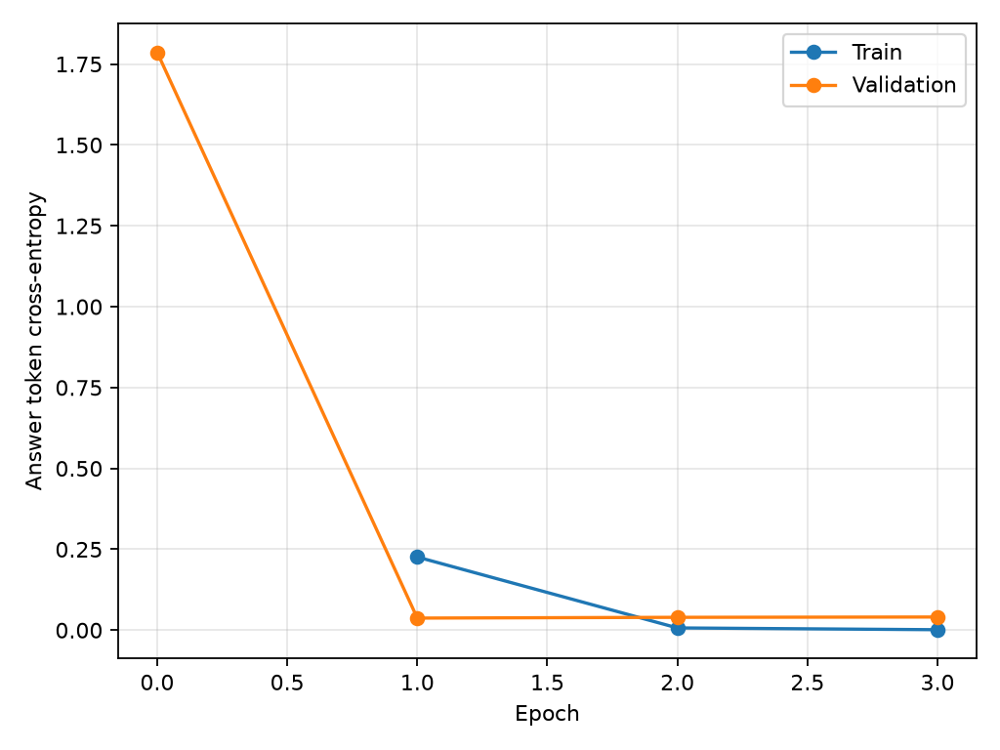

# Расширенное SFT: V1 против V2

Модель в обоих вариантах: Qwen3-0.6B. V1 обучалась на 400 правильных ответах,
V2 — на 4360 (10.9 раза больше). V2 обучалась заново от базовой модели, не от
адаптера V1. Старый адаптер и результаты сохранены в `../v1/` и исходных папках.

## Новый отложенный тест: основной результат

**V1: 14/80 (17.5%); V2: 80/80 (100.0%).**

| Задача | V1 | V2 |
|---|---:|---:|
| Порции | 5/40 | 40/40 |
| Замены | 2/30 | 30/30 |
| Вопросы по рецепту | 7/10 | 10/10 |

Исправлено: 66; регрессий: 0.
80 вопросов на 10 новых семействах рецептов; набор заморожен до запуска V2.
Чекпойнт выбран по validation loss, а не по этому тесту.

Детализация числовых заданий:

| Подзадача | V1 | V2 |
|---|---:|---:|
| Все ингредиенты | 5/20 | 20/20 |
| Один ингредиент с расчётом | 0/10 | 10/10 |
| Перевод единиц | 0/10 | 10/10 |

Метрика означает полное выполнение запроса. У V1 в четырёх вопросах на один
ингредиент правильное итоговое число, но нет явно запрошенного расчёта; это
частичное выполнение и 0 по строгому протоколу. В задачах перевода единиц
повтор исходных граммов не считается выполнением запроса ответить в килограммах.
Все такие случаи пояснены в построчном сравнении, чтобы изменение формата
ответов не было принято за чистое улучшение арифметики.

## Старый тест: регрессии на уже известных задачах

**V1: 24/45 (53.3%); V2: 38/45 (84.4%).**

| Задача | V1 | V2 |
|---|---:|---:|
| Вопросы по рецепту | 14/19 | 17/19 |
| Порции | 1/10 | 9/10 |
| Замены | 1/8 | 4/8 |
| Отказы | 8/8 | 8/8 |

Исправлено: 15; регрессий: 1.
Эти 45 примеров не вошли в обучение, но их ошибки уже были просмотрены при
проектировании V2. Поэтому это проверка регрессий, не независимый новый тест.
Старые оценки V1 сохранены без пересмотра.

Одна оценка пограничная: замена клубники 210 г малины засчитана, хотя подготовка
описана неудачно («нарежьте, слейте»). Если считать и это существенной ошибкой,
результат V2 на старом тесте будет 37/45 (82.2%) вместо 38/45 (84.4%).

## Практический результат и оставшиеся ошибки

На новых отложенных семействах V2 воспроизводит все 80 правильных ответов,
включая 40 числовых задач. Это показывает освоение данного шаблонного
распределения, а не универсальную арифметику или знание всей кулинарии.
Эталоны новых тестов используют те же типы формулировок и правил, что обучение;
поэтому этот тест существенно легче для V2, чем произвольный пользовательский запрос.

На старых рецептах полный пересчёт ингредиентов улучшился с 1/8 до 8/8.
Например, для пудинга на 5 порций V1 давала **750 г чиа**, V2 даёт правильные
**75 г**, вместе с правильными 500 мл молока и 300 г банана.
Следующие шаги и конец рецепта: 6/9 → 9/9. Отказы сохранены: 8/8 → 8/8.
Замены на старом тесте: 1/8 → 4/8 (3/8 при более строгой оценке примера с малиной).

Есть регрессия: в вопросе о первоначальном составе пудинга V1 перечисляла
чиа, молоко и банан правильно, а V2 выдумала сметану и рисовый напиток.
Вопросы о количестве ингредиентов и о пересчёте относятся к разным запросам;
успешная арифметика не гарантирует правильное извлечение состава.

Остались ошибки: «несладкий сахар», «помидорная овсяка», неуместные инструкции
к замене сметаны/горошка, ответ мимо вопроса о калорийности и отсутствие
отклонения нулевого числа порций. Нельзя считать модель готовой к самостоятельным
советам о сложных заменах или аллергиях. Для следующего улучшения нужны
разнообразные естественные вопросы и больше примеров извлечения состава,
а не только новые числовые вариации уже освоенных шаблонов.

## Объём и методика

4360 ответов: 2080 порции, 1180 замены, 820 удержание рецепта, 280 отказы.
200 вариантов рецептов из 80 семейств. Часть примеров — шаблонные вариации порций
и формулировок, а не независимые блюда. Валидация: 245 вопросов на 15 семействах.
Семейства между train, validation и fresh-test не пересекаются, отдельные продукты
и шаблоны вопросов пересекаются. Учитель — ассистент; вычисления эталонов Decimal.

В новом обучении исходные порции варьируются от 1 до 12 (не все целые значения),
есть дробные количества, пересчёт одного продукта и перевод единиц. Многие
количества кратны исходному числу порций; это ограничивает сложность арифметики.
Замены привязаны к типу блюда и ограничениям. Внешний калькулятор при инференсе
не подключался. Никакой коррекции сгенерированных ответов не применялось.

Оба варианта: одинаковый системный промпт, BF16, greedy, thinking выключен,
batch1, предел 160 новых токенов. LoRA сливается с моделью перед измерением.
Различаются не только данные, но и LR/число эпох/число обновлений, поэтому эффект
нельзя полностью приписывать одному увеличению числа примеров.

## Прогресс и loss

Выполнено эпох: 3, обновлений весов: 819,
предъявлений обучающих примеров: 13080.
Время обучения с валидацией: **35.14 мин**.
LoRA r16, alpha32, dropout0.05; LR 0.00008, batch2, accumulation8, seed42.
Первый короткий запуск с batch4 остановлен из-за заполнения видеопамяти;
его веса отброшены, обучение начато заново. Его лог сохранён в pilot_batch4.log.
Время и энергия этого прерванного запуска не включены в показатели завершённого SFT.

Начальный validation loss V2: 1.7863.
Лучший: **0.0373, эпоха 1**.
Train loss на выбранной эпохе: 0.2261.
Абсолютные validation loss V1 и V2 нельзя напрямую сравнивать: состав
валидационной выборки изменился. Вычисляется cross-entropy только по ответу.



## Скорость и оценка стоимости на одном новом тесте

| Метрика | V1 | V2 |
|---|---:|---:|
| Среднее время, с/ответ | 1.993 | 1.681 |
| Медиана, с | 1.822 | 1.879 |
| p95, с | 3.299 | 2.767 |
| Токенов/с | 16.9 | 19.3 |
| Средняя длина, токенов | 33.6 | 32.5 |
| Энергия GPU, Wh/ответ | 0.02548 | 0.02169 |
| RUB/1000 ответов при 6 RUB/kWh | 0.1529 | 0.1301 |

Энергия обучения: примерно 53.25 Wh для GPU,
или 0.3195 RUB при указанном условном тарифе.
Это не полная стоимость: не включены остальные компоненты ПК, амортизация,
разработка и подготовка данных. Мощность GPU измерялась выборками nvidia-smi
раз в секунду, включая фон. В latency не включены загрузка модели и токенизация.
Плата за API локальной модели — ноль; скорость и цена учителя-чата недоступны.

## Проверяемость и ограничения

Семантическую оценку выполнил тот же ассистент, который составил эталоны.
Это не независимая слепая экспертиза. Все 125 сравнений и объяснения находятся
в comparisons.html; сырые ответы — v1_fresh.json, v2_fresh.json, v2_legacy.json.
Результат относится к небольшим синтетическим наборам, а не ко всем рецептам.
Требования к полному ответу и допустимому округлению зафиксированы в
../../evaluation_v2_protocol.md. Учитель не получает искусственный балл 100%
за совпадение с собственными ответами.

Запуск V2 в консоли:

```powershell
.\.venv\Scripts\python.exe chat.py --recipe recipe_example.txt --adapter runs/v2/adapter
```

Повторить эксперимент: `.\run_v2.ps1` (перезапишет V2, но не V1).
Лог: console.log. Модель: adapter/adapter_model.safetensors.
